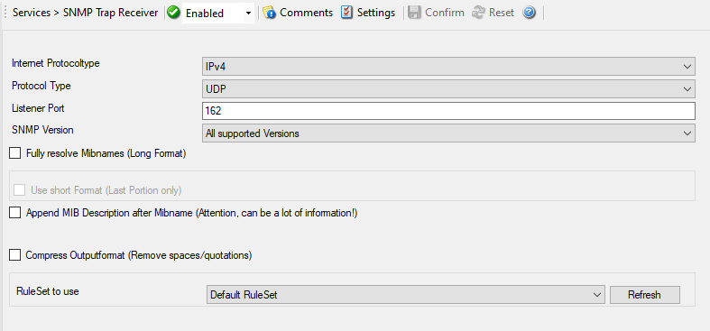

.. _snmp-trap-receiver:

SNMP Trap Receiver
==================

The ``SNMP Trap Receiver`` service receives SNMP messages. A trap is somewhat
like a syslog message over another protocol (SNMP). It is generated by the
device and contains the information that the device decides to transmit, plus a
small set of standard items such as version and community.

The ``SNMP Trap Receiver`` service runs continuously based on the configuration
mentioned below:

* Service - SNMP Trap Receiver*

Internet Protocoltype
^^^^^^^^^^^^^^^^^^^^^

**File Configuration field:**
  nInetType

**Description:**
  Select the desired protocol type. IPv4 and IPv6 are available. The IPv6
  protocol needs to be properly installed in order to be used. Note that one
  Service can only handle IPv4 or IPv6, so if you want to use both protocols,
  you will need to create two separate services.

Protocol Type
^^^^^^^^^^^^^

**File Configuration field:**
  nProtocolType

**Description:**
  You can select whether the ``SNMP Trap Receiver`` service listens on UDP or
  TCP for SNMP traps.

Listener Port
^^^^^^^^^^^^^

**File Configuration field:**
  nPort

**Description:**
  The port the ``SNMP Trap Receiver`` service listens on. If in doubt, leave it at the
  default of 162, which is the standard port for this.

SNMP Version
^^^^^^^^^^^^

**File Configuration field:**
  nSnmpVersion

  * -1 = All Supported Versions

  *  0 = SNMP Version 1 only

  *  1 = SNMP Version 2c only

  .. only:: winsyslog or winsyslog_j or mwagent

     *  3 = SNMPv3 (authentication only; planned)

**Description:**
  Can be used to restrict the SNMP versions. The available values are:

  * All Supported Versions (i.e. SNMP Version 1 and SNMP Version 2c only)

  * SNMP Version 1 only

  * SNMP Version 2c only

  .. only:: winsyslog or winsyslog_j or mwagent

     * SNMPv3 (authentication only; planned)

.. only:: winsyslog or winsyslog_j or mwagent

   SNMPv3 authentication
   ^^^^^^^^^^^^^^^^^^^^^

   .. note::

      SNMPv3 authentication is planned for a future release. Use these settings
      only with service and configuration client builds that explicitly
      include this feature. A newer client does
      not add SNMPv3 support to an older service.

   Select **SNMPv3 (authentication only)** to accept authenticated SNMPv3 traps
   on this receiver. Its ``nSnmpVersion`` value is ``3``. The existing **All
   Supported Versions** choice continues to mean SNMPv1 and SNMPv2c; it does not
   enable SNMPv3. Use a separate receiver and port when both legacy and
   authenticated SNMPv3 reception are required.

   This mode uses the SNMPv3 User-based Security Model (USM) at the
   ``authNoPriv`` security level: messages are authenticated but not encrypted.
   Only SNMPv3 TRAP2 notifications are accepted. Unauthenticated SNMPv3,
   encrypted ``authPriv`` messages and SNMPv3 INFORM notifications are not
   supported. This feature does not change the SNMP Monitor service or the
   Send SNMP Trap action.

   Sender engine ID
   """"""""""""""""

   **File Configuration field:**
     ``szSnmpV3EngineId``

   **Description:**
     Enter the sending device's authoritative engine ID, not the receiver's
     engine ID or the device's IP address. Enter 5 to 32 bytes as 10 to 64
     hexadecimal digits without separators; an optional ``0x`` prefix is
     accepted. An ID consisting entirely of zero bytes or entirely of ``ff``
     bytes is invalid. The configured value must match the sender exactly.

   User name
   """""""""

   **File Configuration field:**
     ``szSnmpV3User``

   **Description:**
     Enter the sender's USM user name. It is case sensitive and must contain
     1 to 32 printable ASCII characters. The user name and engine ID identify
     the sender profile for this receiver.

   Authentication protocol
   """""""""""""""""""""""

   **File Configuration field:**
     ``nSnmpV3AuthProtocol``

   **Description:**
     Select the same authentication protocol as the sender:

     * ``0`` = SHA-1, the default. Some devices and tools call this ``SHA``.
     * ``1`` = MD5, provided for compatibility with existing devices.

     These are HMAC-SHA-1-96 and HMAC-MD5-96 authentication. SHA-2 protocols
     are not available in this feature.

   Authentication passphrase
   """""""""""""""""""""""""

   **File Configuration field:**
     ``szSnmpV3AuthPassword``

   **Description:**
     Enter the same authentication passphrase as the sender. Use 8 to 255
     printable ASCII characters; spaces are significant. The client masks
     the passphrase on screen. Masking does not encrypt it in the configuration
     file or registry. Restrict access to that configuration and its backups,
     and omit the passphrase from screenshots, support files and command
     history.

   Configure and verify reception
   """"""""""""""""""""""""""""""

   1. Obtain the authoritative engine ID and USM settings from the sender.
   2. Create a receiver with a free listener port and the required rule set.
   3. Select SNMPv3 (authentication only) and enter the matching engine ID,
      user name, authentication protocol and passphrase.
   4. Configure the sender to use ``authNoPriv`` and this receiver's address
      and listener port. Save and apply the receiver configuration, then send
      a test trap.
   5. Check the rule set's output. Authenticated messages have
      ``snmp_version`` set to ``3``, ``snmp_securityname`` set to the verified
      user name, and ``snmp_securitylevel`` set to ``authNoPriv``.
      ``snmp_community`` is empty because SNMPv3 has no community string.

   Each receiver accepts one engine ID and user profile. Use additional
   receivers with separate ports for other profiles. Receivers using the same
   engine ID and user must use identical authentication settings; conflicting
   settings prevent the affected receiver from starting. Change the sender
   and receiver credentials together and reapply the configuration when
   rotating a passphrase.

   Wrong credentials, a different engine ID or user, invalid messages and
   unauthenticated traffic do not enter the rule set. There is no fallback to
   unauthenticated reception. When no test message appears, check the sender's
   engine ID and all authentication settings as well as the existing listener,
   network and rule-set configuration.

   USM checks the sender's engine time within a 150-second window. This is not
   an exactly-once delivery guarantee: duplicates within the window can be
   accepted, and this feature does not add persistent replay detection across
   receiver restarts.

Fully resolve MIB names (long format)
^^^^^^^^^^^^^^^^^^^^^^^^^^^^^^^^^^^^^

**File Configuration field:**
  nResolveLongMibNames

**Description:**
  This option fully resolves the MIB names like in the client MIB browser
  application.

Use short format (last portion only)
^^^^^^^^^^^^^^^^^^^^^^^^^^^^^^^^^^^^

**File Configuration field:**
  nResolveMibNamesShort

**Description:**
  Fully resolved MIB names including their tree can become very long and
  unreadable. Use this option to shorten them to the last portion of the full
  MIB name.

Append MIB description after MIB name
^^^^^^^^^^^^^^^^^^^^^^^^^^^^^^^^^^^^^

**File Configuration field:**
  nAddMibDescriptionToMsg

**Description:**
  Append the MIB description after the MIB name. **Attention, this can be a lot
  of information.**

Compress output format (remove spaces/quotations)
^^^^^^^^^^^^^^^^^^^^^^^^^^^^^^^^^^^^^^^^^^^^^^^^^

**File Configuration field:**
  nCompressOutputFormat

**Description:**
  When enabled the output format will be reduced to a minimum and comma
  separated. Here is a sample output:

  ``source=127.0.0.1, community=public, version=Ver2,``
  ``iso.3.6.1.2.1.1.3.0=Timeticks: (3493305159) 404 days, 7:37:31.59,``
  ``iso.3.6.1.6.3.1.1.4.1.0=OID: iso.3.6.1.4.1.19406.1.2.2,``
  ``iso.3.6.1.4.1.19406.1.1.1.7=This is a SyslogTest``

General Values (Common settings for most services)
^^^^^^^^^^^^^^^^^^^^^^^^^^^^^^^^^^^^^^^^^^^^^^^^^^

RuleSet to Use
^^^^^^^^^^^^^^

**File Configuration field:**
  szRuleSetName

**Description:**
  Name of the ruleset to be used for this service. The RuleSet name must be a
  valid RuleSet.

**Please Note:**

**Managing incoming traps works the same way as with the ``Syslog server`` service, for example.**

Incoming traps will be forwarded to the corresponding Ruleset and pass by rule
after rule. There it can be filtered for general information like the
"Community", the "Version" or "Value" for example. Finally it will be processed
by an action, which you can select to your needs. The SNMP Agent service will
co-exist peacefully next to the Windows SNMP Agent and will not hinder it in
its functionality. The Windows SNMP Agent listens to port 161, while
MonitorWare Agent and WinSyslog listen to port 162.**

**For internal processing, the variables of incoming SNMP messages will be added to a new property. Those properties will be named %snmp_var_x% with the x being a number starting with 1. You can use these custom properties for filtering and
everywhere where you can use or print properties. For example, you can create a
"send mail"-action. Here you can specify complete freely how the message will
look like. You can use a introductory text and then let it show the error
message in some context. This could look like this:**

.. code-block:: text

   Hello Admin,
   the following error occurred
   %snmp_var_5%
   Please take care at once.
   Very urgent!

**The result will be, that the 5th property of the snmp trap will be inserted into the message text.**
